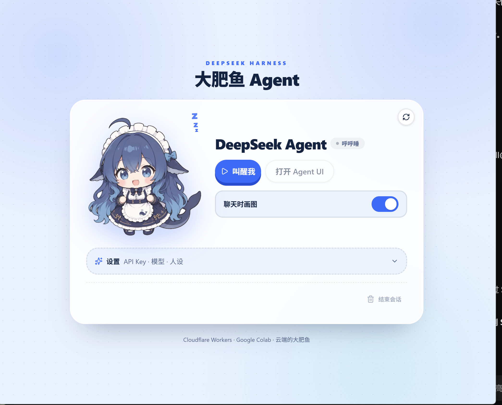

# DSH Agent

A standalone DeepSeek Harness (DSH) control panel. It runs the DeepSeek Agent
inside a Google Colab session and exposes a small web UI for starting,
stopping, configuring, and opening the agent. Optional image generation and a
QQ Bot plugin are included.



## Architecture

Three Cloudflare Workers:

```
Browser ──▶ dsh-agent-web      apps/web          panel UI, /api/dsh proxy
              │  service binding DSH_API
              ▼
            dsh-agent-api      apps/api          public edge: auth, routing,
              │  service binding DSH_COLAB_BRIDGE   Agent UI and image proxy
              ▼
            dsh-colab-bridge   apps/colab-bridge Worker + Container
              │  Docker: Colab CLI, SSH tunnel, Node 24
              ▼
            Colab VM: DSH web UI on :18080, bridge API on :7791
```

- **`dsh-agent-web`** renders the panel and forwards `/api/dsh/*` to the API
  Worker through the `DSH_API` service binding (or `DSH_API_URL` locally).
- **`dsh-agent-api`** is the only public origin: it checks the bearer token on
  control paths, then forwards everything to the container Worker. It also
  serves the DSH Agent UI and generated images, because those URLs are built
  from its origin.
- **`dsh-colab-bridge`** owns the container (`colab-bridge.mjs`, Colab CLI,
  SSH tunnel) and holds the provider/Colab secrets. It has no public URL; only
  the API Worker reaches it.

## Features

- **Agent control** — start/stop the Colab `dsh` session, inspect hardware and
  status, open the DSH Web UI.
- **Identity and provider config** — agent name, persona, personality,
  communication style, additional instructions, API key, base URL, and model.
- **Snapshot cache** — uploads a Node 24 snapshot to Google Drive and restores
  it on later starts.
- **Image generation** — a persistent `sdxl-turbo` worker on a separate GPU
  session, exposed to the agent through MCP (`generate_image`). The panel's
  **会在聊天的时候生成图片** switch decides whether the agent gets that tool at
  all; it is persisted on the bridge and applied on the next start.
- **QQ Bot** — installs and reports the Tencent QQ Bot plugin state, including
  the login QR code.
- **Public image URLs** — generated images are served at unguessable UUID
  paths through the API Worker.
- **Accounts** — the panel is gated by a session cookie. Register with email
  and password, or sign in with Google; users and sessions live in a D1
  database bound as `AUTH_DB`. `/api/dsh/*` returns `401` without a session.

## Requirements

- Node.js 24 and pnpm 11.
- Docker for the Cloudflare Container build.
- A Google account with Colab access and the Colab CLI.
- A Google Cloud project for Drive API quota.
- A DeepSeek-compatible provider key, base URL, and model.

## Local development

Install once, then copy every example environment file:

```bash
pnpm install
cp apps/colab-bridge/.dev.vars.example apps/colab-bridge/.dev.vars
cp apps/api/.dev.vars.example apps/api/.dev.vars
cp apps/web/.dev.vars.example apps/web/.dev.vars
```

Fill the provider and Colab credentials in `apps/colab-bridge/.dev.vars`, and
keep `DSH_BRIDGE_TOKEN` identical across the three files (the examples use
`local-dev-token`).

Apply the account schema to the local D1 database once, and again whenever a
migration is added:

```bash
pnpm --filter @dsh-agent/web exec wrangler d1 migrations apply AUTH_DB --local
```

Google login needs an OAuth client (Google Cloud Console → Credentials →
OAuth client ID, redirect URI `http://localhost:3000/api/auth/google/callback`).
Put its id and secret in `apps/web/.dev.vars` as `GOOGLE_CLIENT_ID` and
`GOOGLE_CLIENT_SECRET`. Leave them empty to use email and password only; the
Google button then redirects back with `?error=google_unconfigured`.

Run the three Workers in three terminals, in this order:

```bash
pnpm dev:colab   # dsh-colab-bridge on 127.0.0.1:7791, builds the container
pnpm dev:api     # dsh-agent-api on 127.0.0.1:8080
pnpm dev         # dsh-agent-web on 127.0.0.1:3000
```

Docker must be running for `dev:colab`; the first build pulls the image. The
API Worker resolves `dsh-colab-bridge` through the wrangler dev registry, so
that Worker has to be running before the panel can show state.

Open <http://localhost:3000>; the panel redirects to `/login` until you
register an account or sign in with Google. The panel reaches the API at
`http://127.0.0.1:8080` (from `apps/web/.dev.vars`), and the API reaches the
container Worker through its service binding.

UI-only loop without Docker: run the bridge as a plain Node process and point
the panel straight at it.

```bash
DSH_BRIDGE_TOKEN=local-dev-token \
  node apps/colab-bridge/scripts/colab-bridge.mjs   # 127.0.0.1:7791
DSH_API_URL=http://127.0.0.1:7791 pnpm dev
```

### MCP server

`apps/mcp` exposes the same control API as MCP tools (state, start, stop,
delete, configure, wait, image generation, QQ Bot):

```bash
pnpm --filter @dsh-agent/mcp build
DSH_API_TOKEN=local-dev-token node apps/mcp/dist/index.js
```

It speaks MCP over stdio and defaults to `http://127.0.0.1:8080`. See
`apps/mcp/README.md` for the tool list and an example client entry.

## Deploy

Deploy in dependency order: container Worker, API Worker, panel Worker.

1. `dsh-colab-bridge` — secrets and the container image.

```bash
pnpm --filter @dsh-agent/colab-bridge exec wrangler secret put DSH_BRIDGE_TOKEN
pnpm --filter @dsh-agent/colab-bridge exec wrangler secret put DEEPSEEK_API_KEY
pnpm --filter @dsh-agent/colab-bridge exec wrangler secret put DEEPSEEK_BASE_URL
pnpm --filter @dsh-agent/colab-bridge exec wrangler secret put DEEPSEEK_MODEL
pnpm --filter @dsh-agent/colab-bridge exec wrangler secret put COLAB_OAUTH_TOKEN
pnpm --filter @dsh-agent/colab-bridge exec wrangler deploy
```

`GOOGLE_CLOUD_PROJECT` is optional and only needed for the Drive snapshot
cache; set it with `wrangler secret put` to a project with the Drive API
enabled, then redeploy.

2. `dsh-agent-api` — same bridge token, then deploy. Its
   `DSH_COLAB_BRIDGE` binding finds the Worker by name.

```bash
pnpm --filter @dsh-agent/api exec wrangler secret put DSH_BRIDGE_TOKEN
pnpm --filter @dsh-agent/api exec wrangler deploy
```

3. Point the container Worker at the API origin, so the Agent UI link and
   generated image URLs use the host the browser actually reached.

```bash
pnpm --filter @dsh-agent/colab-bridge exec wrangler deploy \
  --var DSH_PUBLIC_URL:https://<api-worker>.workers.dev
```

4. `dsh-agent-web` — same token, the auth database, then deploy.

```bash
# once: copy the printed database_id into apps/web/wrangler.jsonc
pnpm --filter @dsh-agent/web exec wrangler d1 create dsh-auth
pnpm --filter @dsh-agent/web exec wrangler d1 migrations apply AUTH_DB --remote
pnpm --filter @dsh-agent/web exec wrangler secret put DSH_API_TOKEN
pnpm --filter @dsh-agent/web exec wrangler secret put GOOGLE_CLIENT_ID
pnpm --filter @dsh-agent/web exec wrangler secret put GOOGLE_CLIENT_SECRET
pnpm --filter @dsh-agent/web run deploy
```

The Google OAuth client for the deployed host needs the redirect URI
`https://<panel-worker>/api/auth/google/callback`.

## Security

This is a **single-tenant** stack. One container owns one Colab session and
one config file. The panel requires a session: pages redirect to `/login` and
`/api/dsh/*` answers `401` without one. Passwords are PBKDF2-SHA256 (100k
iterations); sessions are 30-day `HttpOnly`, `SameSite=Lax` cookies whose
database rows store only the SHA-256 of the token.

**Registration is open**: anyone who can reach the panel hostname can create
an account and control the container. Restrict the hostname (Cloudflare
Access, a private network) if that is not what you want.

The Agent UI and generated images are served by `dsh-agent-api`, outside the
panel's session gate: the DSH web server enforces its own token, and image
URLs are public by UUID. Put an authentication layer in front of the API
origin before using a public hostname. The container filesystem is ephemeral:
config and snapshot cache are lost when the container is replaced.

`dsh-colab-bridge` is deployed with `workers_dev: false`; it must stay
reachable only through the API Worker's service binding.

## Layout

```
apps/web/           dsh-agent-web: TanStack Start UI and /api/dsh proxy
apps/web/migrations D1 schema for accounts and sessions
apps/api/           dsh-agent-api: public edge, bearer auth, routing
apps/colab-bridge/  dsh-colab-bridge: Worker, Docker container, bridge script
apps/mcp/           MCP stdio server over the control API
packages/contract/  Shared Zod schemas and types
```
